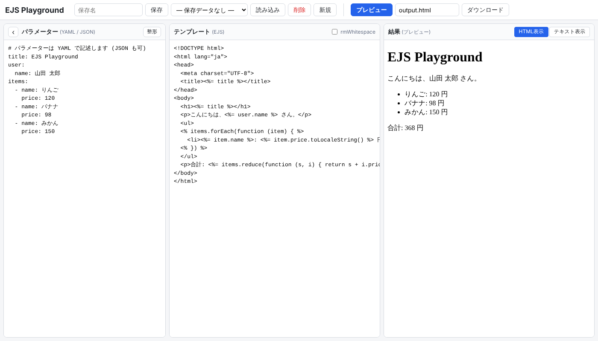

# EJS Playground

ブラウザ上で [EJS](https://ejs.co/) テンプレートを試せる静的Webアプリです。GitHub Pages でそのまま公開できます。

**▶ 公開ページ: https://cwan.github.io/ejs-playground/**



## 機能

- **パラメーター入力** (YAML。JSONも可) / **テンプレート入力** (EJS) / **結果出力** の3ペイン構成
- パラメーター領域は折りたたみ可能 (テンプレートと結果を広く表示。状態は保存されます)
- 「プレビュー」(Ctrl/⌘+Enter) で変換結果を表示 (HTML表示 / テキスト表示 を切替)
- 「ダウンロード」で変換結果をファイル保存 (ファイル名は任意、拡張子からMIMEタイプを判定)
- パラメーターとテンプレートを **名前をつけて複数保存** (ローカルストレージ)
  - 保存 (Ctrl/⌘+S) / 読み込み / 削除 / 新規
  - 編集中の内容も自動保存され、再訪時に復元されます
- `<%- include('保存名') %>` で保存済みの別テンプレートをインクルード可能

## ファイル構成

```
index.html        画面
style.css         スタイル
app.js            アプリ本体
vendor/ejs.min.js EJS 3.1.10 ブラウザ版 (Apache-2.0, vendor/EJS-LICENSE)
vendor/js-yaml.min.js js-yaml 4.3.2 (MIT, vendor/JS-YAML-LICENSE)
.nojekyll         GitHub Pages の Jekyll 処理を無効化
```

ビルド不要・外部CDN依存なしです。ローカルでは `index.html` を直接開くか、`python3 -m http.server` で確認できます。

## GitHub Pages への公開

1. このフォルダの内容をリポジトリにプッシュ
2. リポジトリの **Settings → Pages** で *Deploy from a branch* を選び、ブランチ (例: `main`) とフォルダ `/ (root)` を指定
3. 数分後に `https://<ユーザー名>.github.io/<リポジトリ名>/` で公開されます

## 注意

- テンプレート内のJavaScriptはこのページ上で実行されます。信頼できないテンプレートは貼り付けないでください。
- HTMLプレビューはサンドボックス化された iframe 内に表示されます。
- 保存データはブラウザ単位・オリジン単位で保持されます。
